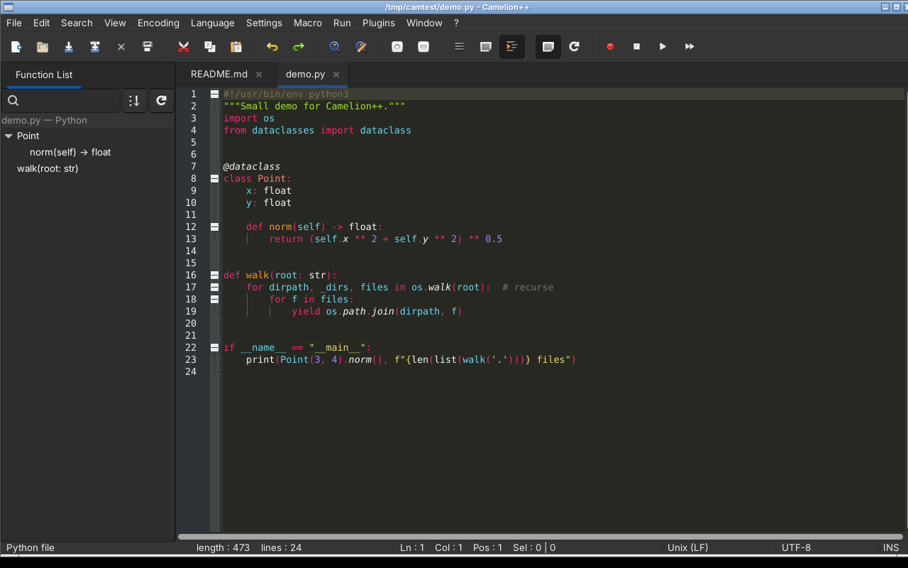
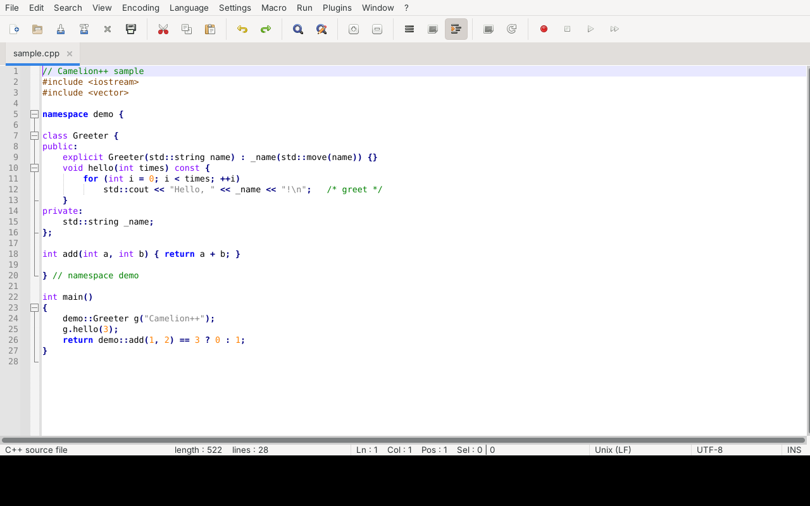
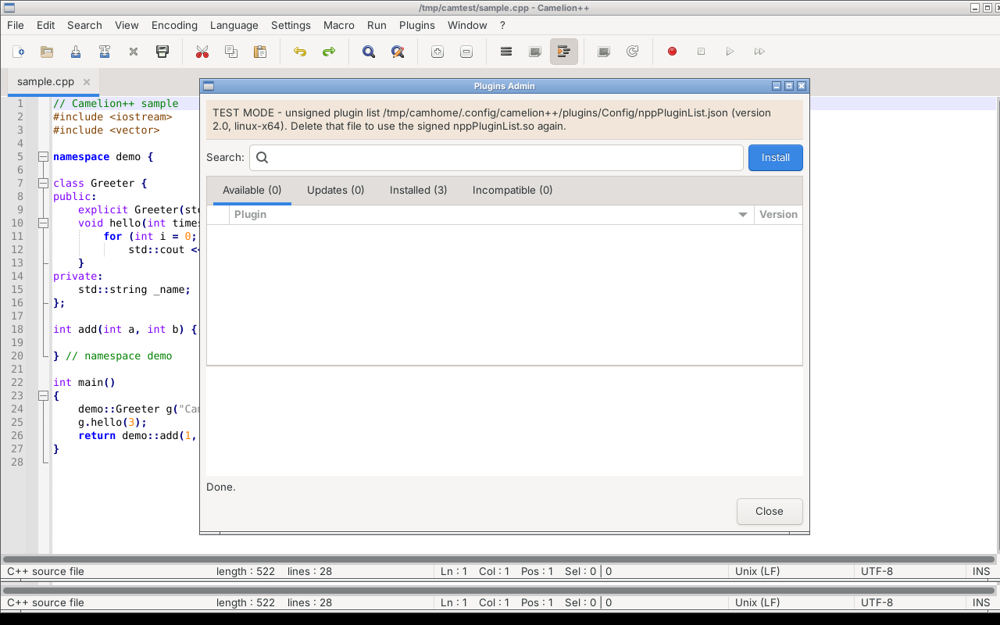

# Camelion++

**A Notepad++ alternative for Linux.**

Camelion++ is a free, open-source source code and text editor that looks and works like
Notepad++, but runs natively on Linux. It uses the same editing engines as Notepad++,
**Scintilla** and **Lexilla**, and reads Notepad++'s own configuration files. Syntax colours, themes,
auto-completion and the function list therefore behave the way Notepad++ users expect.



Camelion++ started as *Camelion*, a self-study of how Notepad++ is built and packaged.
It is an independent project, not affiliated with or endorsed by the Notepad++ project, and it is
not related to Notepadqq.

---

## Contents

- [What it can do](#what-it-can-do)
- [Install on Ubuntu or Debian](#install-on-ubuntu-or-debian)
- [Install on Arch Linux](#install-on-arch-linux)
- [First steps](#first-steps)
- [Uninstalling](#uninstalling)
- [Plugins](#plugins)
- [Building from source (other distributions)](#building-from-source-other-distributions)
- [Licence](#licence)

---

## What it can do

**Editing**
- Tabs (drag to reorder, middle-click to close), with unsaved files shown in red
- Syntax highlighting for 95 languages, plus Markdown, using Notepad++'s language definitions
- 22 colour themes from Notepad++ (Monokai, Solarized, Zenburn, Obsidian, ...), with a dark interface for dark themes
- Code folding, brace matching, smart highlighting of the selected word, bookmarks, change-history margin
- Auto-completion of functions, words and file paths, function parameter hints, auto-indent
- Column (block) selection with Alt+drag, multi-caret editing and the Column Editor
- Line tools: duplicate, move, join, split, sort (8 ways), remove duplicate/empty lines
- Case conversion, comment/uncomment, trim spaces, tabs ↔ spaces

**Search**
- Find, Replace, Find in Files, and Mark, in normal, extended (`\n`, `\t`) or regular-expression mode
- "Find All" results panel; jump between results with F4 / Shift+F4

**Files**
- Encodings: UTF-8, UTF-8 with BOM, UTF-16, and 21 older character sets (Windows-1252, ISO-8859, Shift-JIS, ...)
- Windows, Unix and Mac line endings, detected and convertible
- Session restore: your open files, **including unsaved changes and new documents**, come back after a restart
- Warns when a file changes on disk; "Monitoring" mode follows log files like `tail -f`

**Tools**
- Function List panel, macros (record / play / save), Run menu for external commands, printing
- Plugins, installed with one click from **Plugins Admin**

| Light theme | Plugins Admin |
|---|---|
|  |  |

---

## Install on Ubuntu or Debian

**Supported:** Ubuntu 24.04 or newer, Debian 12 or newer (64-bit PC, `amd64`).

### Option 1: install the ready-made package (Ubuntu 24.04+)

The `.deb` package on the [Releases](https://github.com/SHOPNO105/CamelionPlusPlus/releases) page is built on
Ubuntu 24.04. Open a terminal and run:

```bash
wget https://github.com/SHOPNO105/CamelionPlusPlus/releases/download/v1.0.0/camelion-plus-plus_1.0.0_amd64.deb
sudo apt install ./camelion-plus-plus_1.0.0_amd64.deb
```

`apt` installs everything Camelion++ needs automatically. Then start **Camelion++** from your
applications menu, or type `camelion++` in a terminal.

If `apt` reports missing or too-old packages, which can happen on Debian or older releases, use Option 2.

### Option 2: build your own package (Debian 12+, Ubuntu 24.04+)

This compiles Camelion++ on your machine and turns it into a `.deb`, so it can be removed cleanly later.

**1. Install the build tools and libraries:**

```bash
sudo apt update
sudo apt install build-essential cmake ninja-build pkg-config git \
     libgtk-3-dev libcurl4-openssl-dev libarchive-dev libssl-dev \
     libtinyxml2-dev nlohmann-json3-dev
```

**2. Download the source and build** (takes a few minutes):

```bash
git clone https://github.com/SHOPNO105/CamelionPlusPlus.git
cd CamelionPlusPlus
cmake -S . -B build -G Ninja -DCMAKE_BUILD_TYPE=Release -DCMAKE_INSTALL_PREFIX=/usr
cmake --build build
```

**3. Make the package and install it:**

```bash
cd build
cpack -G DEB
sudo apt install ./camelion-plus-plus_1.0.0_amd64.deb
```

---

## Install on Arch Linux

Arch users build Camelion++ with the included `PKGBUILD`, so `pacman` manages it like any other package.

> **Important:** use a folder whose path has **no spaces**. `makepkg` fails in paths such as
> `~/My Projects/...`.

### Option 1: with makepkg (recommended)

```bash
sudo pacman -S --needed base-devel git
git clone https://github.com/SHOPNO105/CamelionPlusPlus.git
cd CamelionPlusPlus/packaging/arch
makepkg -si
```

- `makepkg` downloads the `v1.0.0` source, installs the dependencies (gtk3, curl, libarchive, openssl,
  tinyxml2, cmake, ninja, nlohmann-json), compiles, and installs the package.
- When it asks, enter your password and confirm with **Y**.
- Compiling takes about 3–10 minutes.

To rebuild after a failed attempt, start clean with `makepkg -siC`.

### Option 2: build and install manually

```bash
sudo pacman -S --needed base-devel git cmake ninja pkgconf gtk3 curl libarchive openssl tinyxml2 nlohmann-json
git clone https://github.com/SHOPNO105/CamelionPlusPlus.git
cd CamelionPlusPlus
cmake -S . -B build -G Ninja -DCMAKE_BUILD_TYPE=Release -DCMAKE_INSTALL_PREFIX=/usr
cmake --build build
sudo cmake --install build
```

This way `pacman` does not know about Camelion++. See [Uninstalling](#uninstalling).

---

## First steps

Check that it is installed:

```bash
camelion++ --version
camelion++ --check-pluginlist     # should say:  signature : verified
```

Open files from the terminal:

```bash
camelion++ notes.txt main.cpp       # open files
camelion++ main.cpp:120             # open at line 120
camelion++ -lpython script          # force a language
camelion++ --help                   # all options
```

If Camelion++ is already open, these files open as new tabs in the same window.

**Useful shortcuts** (the same as Notepad++)

| Keys | Action | Keys | Action |
|---|---|---|---|
| Ctrl+F / Ctrl+H | Find / Replace | Ctrl+D | Duplicate line |
| Ctrl+Shift+F | Find in Files | Ctrl+Shift+↑ / ↓ | Move line up / down |
| F3 / Shift+F3 | Find next / previous | Ctrl+Q | Comment / uncomment |
| Ctrl+G | Go to line | Ctrl+F2 / F2 | Toggle / next bookmark |
| Alt+0 / Alt+Shift+0 | Fold / unfold all | Ctrl+Space | Auto-complete |
| F5 | Run a command | F11 | Full screen |

**Themes:** Settings → Theme, or Settings → Style Configurator to change the font too.

**Compile and run a C++ file:** press **F5** and enter a command that opens your terminal. For Konsole:

```
konsole -e bash -c 'cd "$(CURRENT_DIRECTORY)" && g++ -std=c++17 -Wall -O2 "$(FILE_NAME)" -o "$(NAME_PART)" && ./"$(NAME_PART)"; read -p "Press Enter"'
```

With GNOME Terminal, use `gnome-terminal -- bash -c '...'` instead. Click **Save...** in that dialog to
keep the command in the **Run** menu.

**Your settings** are stored in `~/.config/camelion++/`. Plugins you install go to `~/.local/share/camelion++/plugins/`.

---

## Uninstalling

| Installed with | Remove with |
|---|---|
| `.deb` package (Ubuntu / Debian) | `sudo apt remove camelion-plus-plus` |
| `makepkg` (Arch) | `sudo pacman -R camelion-plus-plus` |
| `cmake --install` (manual) | `sudo xargs rm < build/install_manifest.txt` (run in the source folder) |

To also delete your settings and plugins:
`rm -rf ~/.config/camelion++ ~/.local/share/camelion++`

---

## Plugins

Camelion++ comes with three plugins:

| Plugin | What it does |
|---|---|
| **Converter** | ASCII ↔ HEX conversion |
| **MIME Tools** | Base64, URL and Quoted-printable encode / decode |
| **Document List** | Side panel listing all open documents |

More plugins can be installed from **Plugins → Plugins Admin**. It checks the plugin list's digital
signature and each download's checksum before installing anything.

Notepad++ plugins for Windows (`.dll` files, such as NppExec) **cannot** run on Linux. Camelion++ plugins are
Linux `.so` files written for Camelion++. Anyone can write one:

- **Writing plugins:** [docs/PLUGIN_SDK.md](docs/PLUGIN_SDK.md). The API mirrors Notepad++'s, so many plugins port easily.
- **The plugin list (CamPlugin):** the [`CamPlugin/`](CamPlugin/) folder holds the list that Plugins Admin uses. To add
  your plugin, open a pull request there.

---

## Building from source (other distributions)

Camelion++ needs a C++17 compiler, CMake ≥ 3.16, and the development files for
GTK 3, libcurl (≥ 7.85), libarchive, OpenSSL, tinyxml2 and nlohmann-json.

These package names are believed correct but have not been tested yet:

| Distribution | Install the requirements |
|---|---|
| Fedora | `sudo dnf install gcc-c++ cmake ninja-build gtk3-devel libcurl-devel libarchive-devel openssl-devel tinyxml2-devel json-devel` |
| openSUSE | `sudo zypper install gcc-c++ cmake ninja gtk3-devel libcurl-devel libarchive-devel libopenssl-devel tinyxml2-devel nlohmann_json-devel` |

Then:

```bash
cmake -S . -B build -G Ninja -DCMAKE_BUILD_TYPE=Release -DCMAKE_INSTALL_PREFIX=/usr
cmake --build build
./build/camelion++            # run without installing, or:
sudo cmake --install build
```

Technical details (file locations, the plugin system, how the signed plugin list works, and the
differences from Notepad++) are in [docs/TECHNICAL.md](docs/TECHNICAL.md).

---

## Licence

Camelion++ is free software under the **GNU General Public License v3.0 or later**; see [LICENSE](LICENSE).

- It includes data files from Notepad++ (© Don HO and the Notepad++ contributors, GPL-3).
- Scintilla and Lexilla are © Neil Hodgson, under their own licence (`third_party/*/License.txt`).
